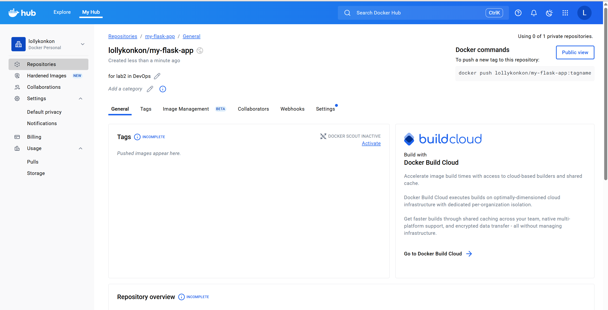
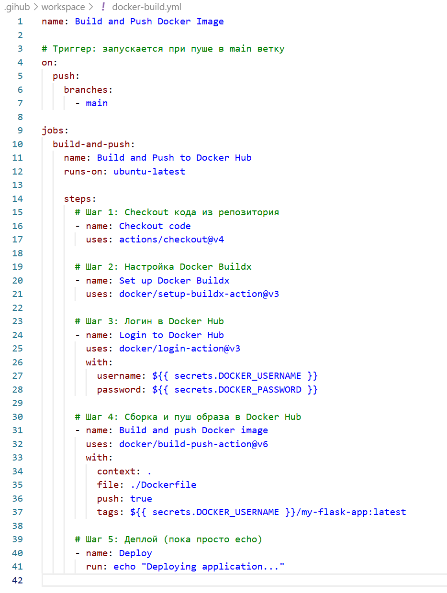
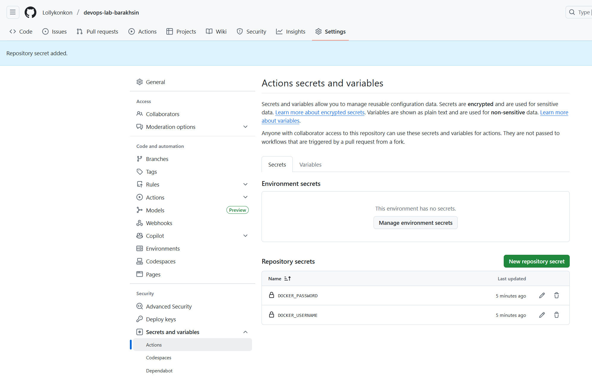
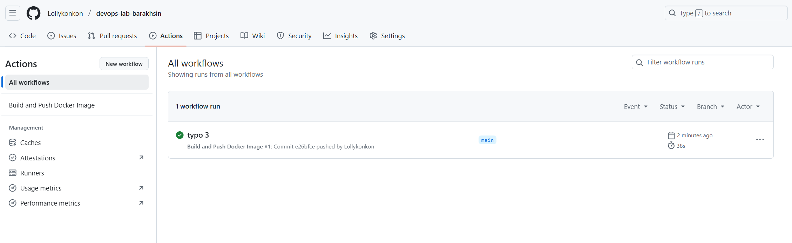
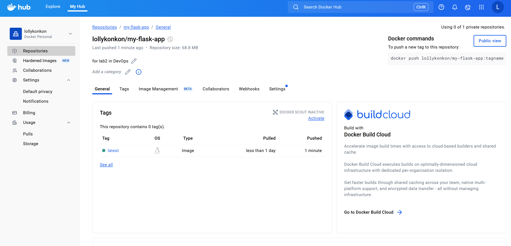

University: [ITMO University](https://itmo.ru/ru/) \
Faculty: [FTMI](https://ftmi.itmo.ru/) \
Course: [Introduction to WEB Technologies](https://my.itmo.ru/programs/38471?p=mainRPD) \
Year: 2025/2026 \ 
Group: U4225 \ 
Author: Barakhsin Grigorii Mikhailovich \
Lab: Lab0 \
Date of create: 14.10.2025 \
Date of finished: TBD 

# Настройка CI/CD пайплайна с GitHub Actions 
new DockerHub repo \

docker-build.yml file contents \

secrets created \

GitHub actions check \

DockerHub check \

timing matches!
