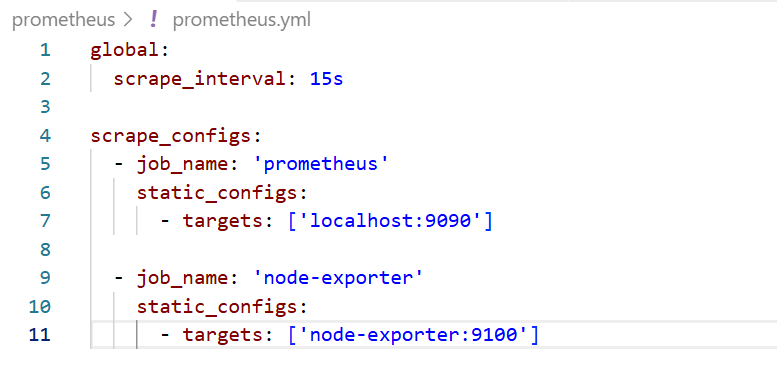
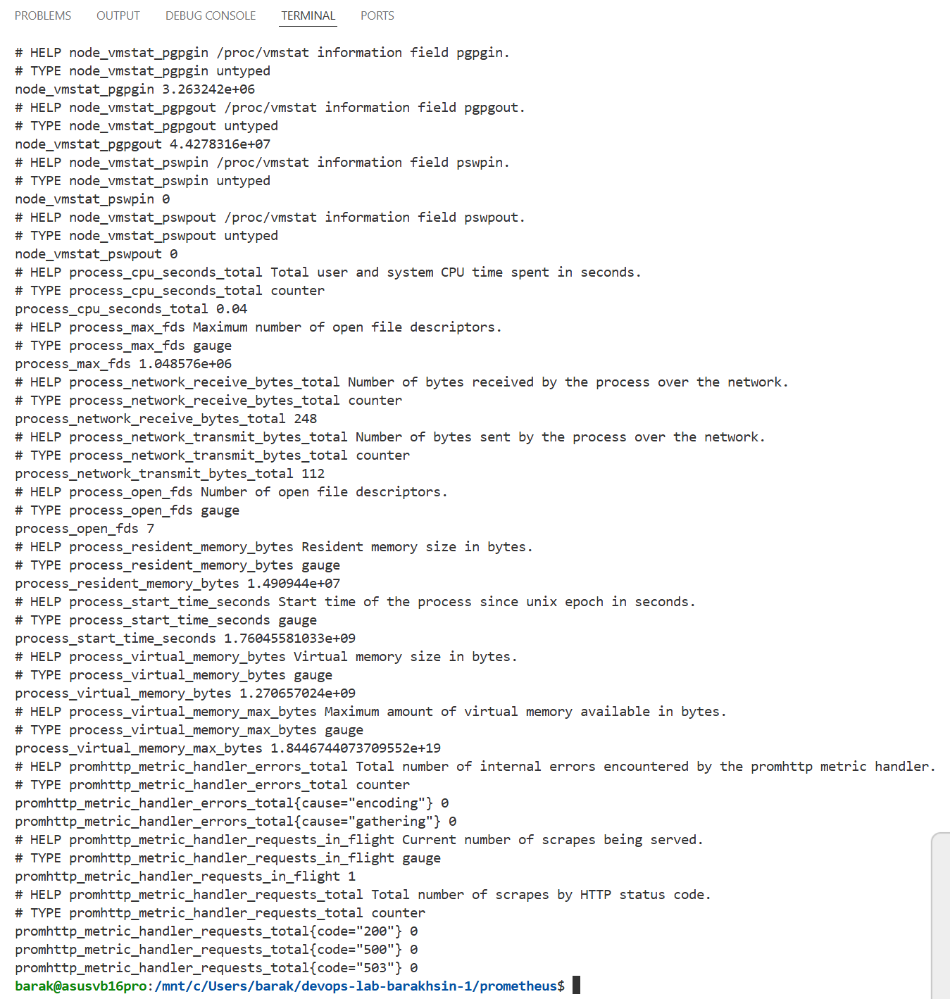
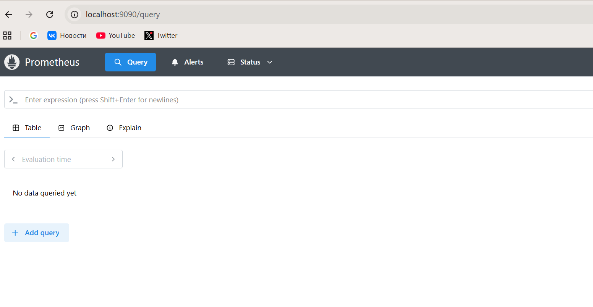
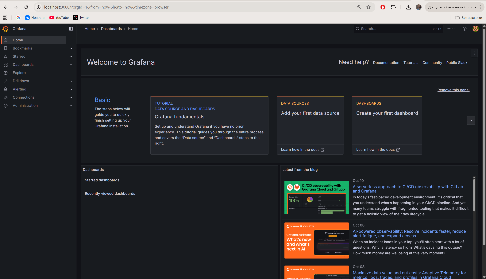
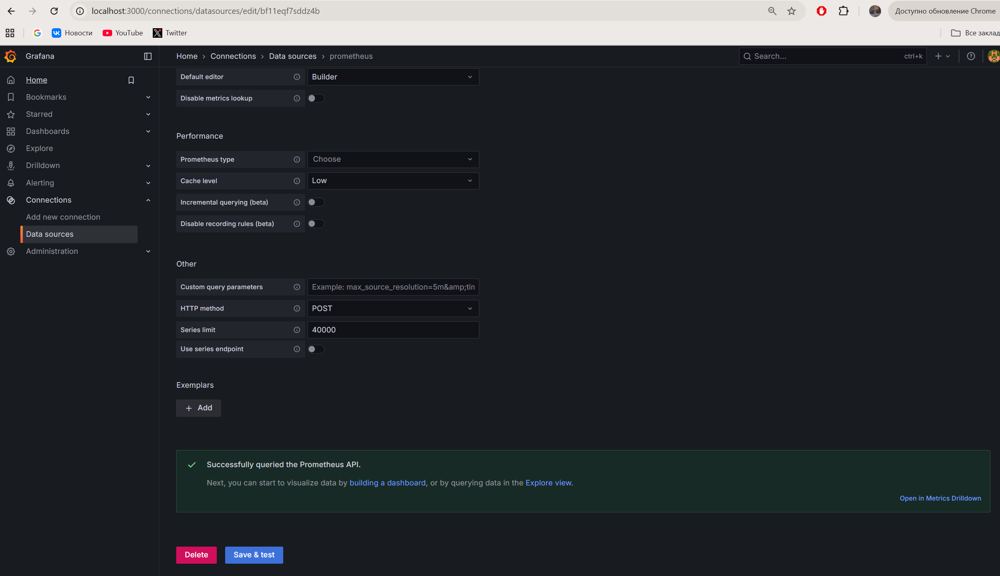
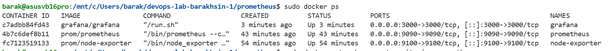

University: [ITMO University](https://itmo.ru/ru/) \
Faculty: [FTMI](https://ftmi.itmo.ru/) \
Course: [Introduction to WEB Technologies](https://my.itmo.ru/programs/38471?p=mainRPD) \
Year: 2025/2026 \ 
Group: U4225 \ 
Author: Barakhsin Grigorii Mikhailovich \
Lab: Lab0 \
Date of create: 14.10.2025 \
Date of finished: TBD 

# Настройка мониторинга с Prometheus и Grafana 
Prometheus config \

Node Exporter logs \

Prometheus check \

Graphana check \

Graphana + Prometheus \

Docker containers \

Dashboards \

