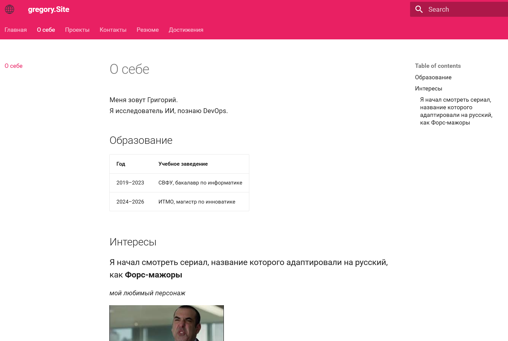
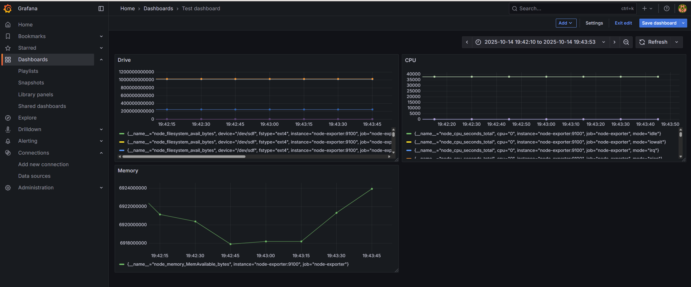

# Проекты

## Проект 1: Сайт-портфолио
**Технологии:** MkDocs, Material, GitHub Pages  
**Описание:** Персональный сайт с использованием MkDocs     
**Репозиторий:** https://github.com/Lollykonkon/devops-lab-barakhsin  

## Проект 2: DevOps-лаборатория
**Технологии:** Docker, WSL2, Prometheus, Grafana  
**Описание:** Контейнеризированный стек для мониторинга и логирования
**Ссылка на репозиторий:** https://github.com/Lollykonkon/devops-lab-barakhsin
